<h1 align="center">OBS Brand Kit</h1>

<p align="center">
  <b>One <code>brand.json</code> in, a complete animated stream package out.</b><br>
  Scene collection for OBS · <code>.overlay</code> for Streamlabs · no paid packs, no leaked keys.
</p>

<p align="center">
  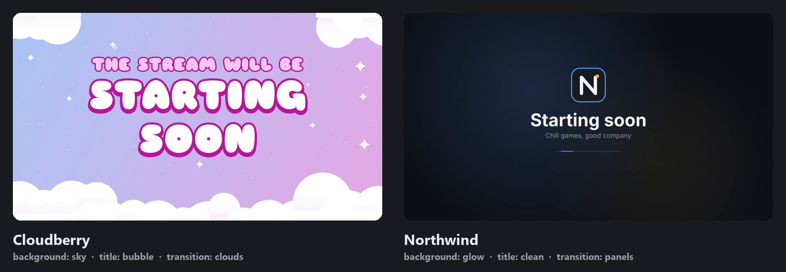
</p>

<p align="center">
  <i>Same code, two <code>brand.json</code> files. Every image on this page is real build output.</i>
</p>

---

## What you get

<table>
  <tr>
    <td width="50%" align="center"><br><sub><b>Starting · BRB · Ending</b> loops (Cloudberry)</sub></td>
    <td width="50%" align="center">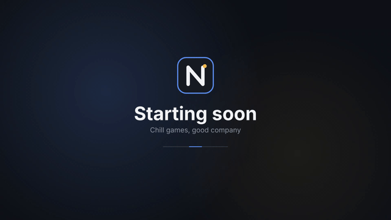<br><sub><b>Starting · BRB · Ending</b> loops (Northwind)</sub></td>
  </tr>
  <tr>
    <td align="center">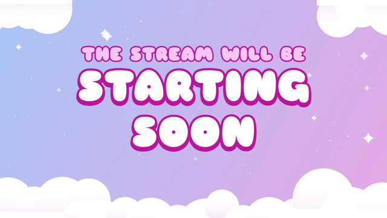<br><sub><b>Stinger:</b> clouds roll in, the scene switches while covered, clouds roll off</sub></td>
    <td align="center">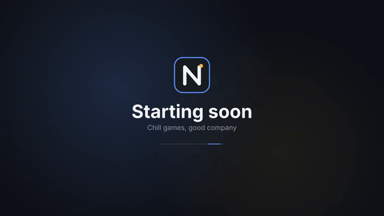<br><sub><b>Stinger:</b> two-panel wipe with the logo</sub></td>
  </tr>
</table>

### Every scene a streamer needs

Rendered by OBS itself after importing the kit. Webcam and game areas are black until you pick your devices.

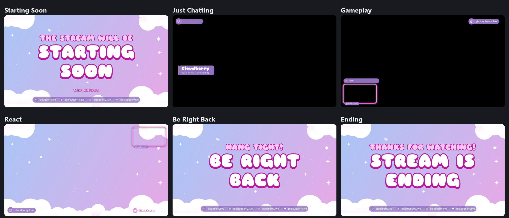

<details>
<summary><b>Same scenes, Northwind style</b></summary>
<br>
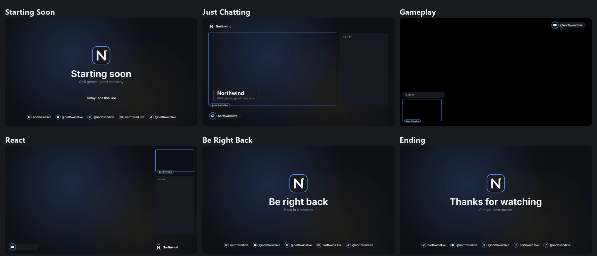
</details>

### Vertical too (TikTok, Shorts, Reels)

Every scene also comes in **1080×1920**, on the canvas the
[Aitum Vertical](https://github.com/Aitum/obs-vertical-canvas) plugin uses. If the streamer has the
plugin, the vertical scenes show up in its dock and **follow the horizontal ones** (switch to Gameplay,
vertical switches to Gameplay (V)). If they don't, nothing changes: the vertical scenes stay hidden.
Webcam, alert box and music are shared with horizontal, so they're set up once. The vertical scenes
use the brand's portrait stinger: double-click `Add vertical stinger.cmd` in the kit once (OBS closed)
to add it to the plugin's transition list.

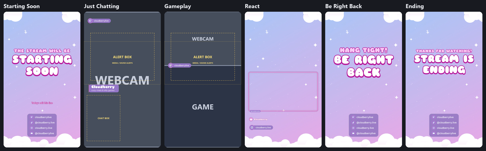

<sub>Rendered by OBS on the Aitum Vertical canvas. Just Chatting and Gameplay show the layout with labelled
stand-ins where your webcam and game go (dashed boxes are the widget slots).</sub>

<details>
<summary><b>Northwind vertical</b></summary>
<br>
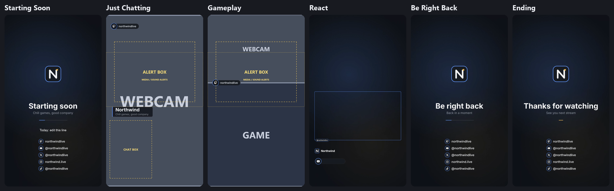
</details>

### The parts

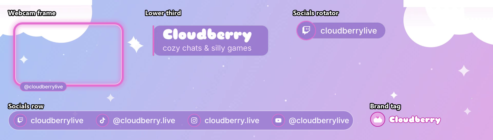

<details>
<summary><b>Northwind parts</b></summary>
<br>
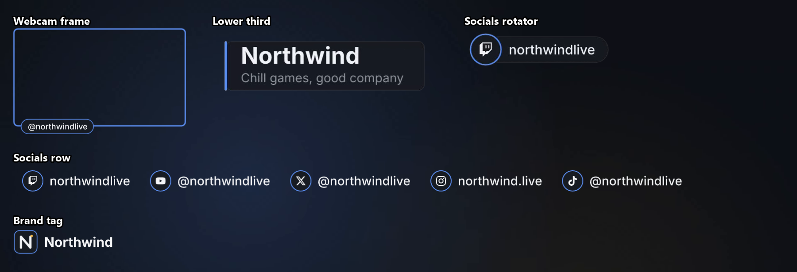
</details>

| Asset | Format | Where it's used |
|---|---|---|
| 🎬 Starting / BRB / Ending screens | seamless loop, WebM | full-screen scenes |
| 🌌 Background loop | WebM | Just Chatting, React |
| ✨ Stinger | WebM with transparency + soft whoosh | every scene change |
| 🏷️ Lower third (name + tagline) | WebM with transparency, plays once | Just Chatting |
| 🔁 Socials rotator | WebM with transparency | Just Chatting, Gameplay, React |
| 🖼️ Webcam frames, socials row, chat panel, "Latest" pill, brand tag | PNG | all over |
| 🔔 Alert box, chat, goals, events, viewer count, now playing | placeholder browser sources | paste your own links |

---

## How it works

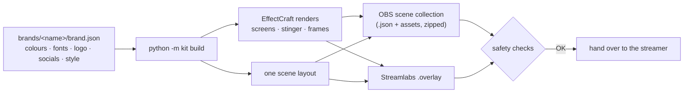

## Make a kit in 3 steps

**1. Describe the brand.** Copy a sample (`brands/northwind` or `brands/cloudberry`) to
`brands/<their-name>/` and edit `brand.json`:

```jsonc
{
  "name": "Cloudberry",
  "handle": "cloudberrylive",
  "tagline": "cozy chats & silly games",
  "palette": { "bg": "#A9C6F6", "bg2": "#E7A8E6", "primary": "#E46FD0", "outline": "#B8179C", ... },
  "fonts":   { "heading": "Sniglet", "heading_style": "ExtraBold", "body": "Inter" },
  "logo": "logo.svg",
  "socials": [ { "platform": "twitch", "handle": "cloudberrylive" }, ... ],
  "style":   { "background": "sky", "title": "bubble", "frame_glow": true, "motion": "lively" },
  "layout":  { "just_chatting": "fullcam", "chat": "floating", "chat_on_screens": true },
  "transition": { "style": "clouds" },
  "text":    { "starting_kicker": "The stream will be", "starting": "Starting soon", ... }
}
```

**2. Build** (about 2 minutes):

```bash
python -m kit build brands/<their-name>
```

**3. Hand over** `dist/<Name> Brand Kit (OBS).zip` and/or `dist/<Name> Brand Kit.overlay`.
The zip contains `IMPORT.md`, a step-by-step guide for the streamer.

> 💡 Changed only text or layout? Add `--skip-render`. Re-render a single piece with `--only lower_third,stinger`.

## Pick a look

| Option | Choices | What it does |
|---|---|---|
| `style.background` | `glow` · `sky` | dark with two soft drifting glows, or a pastel gradient with clouds and twinkling sparkles (`palette.bg` → `palette.bg2`) |
| `style.title` | `clean` · `bubble` | crisp heading, or big rounded outlined titles in `palette.outline` |
| `style.frame_glow` | `true` · `false` | soft glow and a light rim around webcam frames |
| `style.radius` / `style.stroke` | numbers | corner roundness and frame thickness |
| `style.motion` | `calm` · `lively` | 12 s or 8 s loops, slower or quicker socials |
| `style.screen_logo` | `true` · `false` | logo above the screen titles |
| `layout.just_chatting` | `framed` · `fullcam` | webcam beside the chat, or filling the screen with goals on the side |
| `layout.chat` | `panel` · `floating` | chat inside a branded panel, or bubbles straight on the scene |
| `layout.chat_on_screens` | `true` · `false` | show chat on Starting / BRB / Ending |
| `transition` | `{"style": "panels"}` · `{"style": "clouds"}` · `{"file": "x.webm", "point_ms": 800}` | wipe, cloud roll-in, or your own transparent stinger |
| `text.*_kicker` / `text.*_sub` | text, or `""` | small line above / below each title (empty hides it) |
| `vertical` | `true` (default) · `false` | add the 1080×1920 scenes for Aitum Vertical (portrait screens, stinger and socials column are rendered too) |

Other fields: `palette` (`bg`, `surface`, `primary`, `accent`, `text`, `muted`, optional `bg2`,
`outline`, `cloud`), `fonts` (any installed font; list free font files in `fonts.files` to ship
them), `logo` (`.svg` or `.png`, or leave it out for a monogram), and up to 6 `socials` from
`twitch, youtube, x, instagram, tiktok, snapchat`.

## Importing (for the streamer)

| | OBS Studio | Streamlabs Desktop |
|---|---|---|
| File | `<Name> Brand Kit.json` in the unzipped folder | `<Name> Brand Kit.overlay` |
| Menu | Scene Collection ▸ **Import** | Settings ▸ Scene Collections ▸ **Import Overlay File** |
| Widgets | paste your own links into the `PASTE_YOUR_…` sources | linked to your Streamlabs account automatically |
| Your other collections | untouched | untouched |
| Vertical scenes | automatic with Aitum Vertical (OBS 31+); on OBS 30 or older import `… (horizontal only).json` | horizontal only |

## 🔒 Safety

- **Nothing private ships.** Widget sources are `about:blank#PASTE_YOUR_…_URL`: transparent until the
  streamer pastes their own link. `.overlay` widgets are blank.
- **The build refuses to finish** if it finds a web URL, a token-like string, a local path or a missing file.
- **Tests** (`python -m unittest discover -s tests`) also check the output against every key and handle
  in the reference collection on this PC (read at test time, never stored).
- **Portable:** every file path is relative (`./assets/...`), so the kit works on any PC.

## Connect the tools you already use (optional)

Already streaming with another collection? The connect tools build a **personal** copy of your kit wired
to the alert box, chat, now-playing, sound alerts, camera, capture card and mics that collection really
uses, and leave out everything it doesn't:

```bash
python -I tools/obs_inventory.py list
python -I tools/obs_inventory.py tools "<your collection>"
python -I tools/obs_connect.py <your folder>/plan.json
python tools/obs_connect_check.py "<new collection>" --out <folder>
```

Your links and tokens go straight into the new collection in OBS, never into this repo, and your old
collection is only read. Guide and plan format: [`docs/CONNECT.md`](docs/CONNECT.md).

## Testing in OBS

```bash
python tools/verify_obs.py "dist/<slug>/<Name> Brand Kit.json" --out <folder>
```

Close OBS first. The script loads the kit as a new collection `<Name> Brand Kit (test import)`,
checks every file, screenshots every scene, then puts OBS back on your previous collection.
It never overwrites a collection. Remove the test collection in OBS when you're done.

README images: `python tools/readme_images.py --obs-shots <slug>=<verify_obs output folder> ...`
(needs Pillow and ffmpeg).

---

<sub>Docs: <a href="docs/PRD.md">PRD</a> · <a href="docs/ARCHITECTURE.md">Architecture</a> (formats, decisions) · <a href="docs/ARCHITECTURE-ESSENTIALS.md">Essentials</a>. Icons: <a href="https://simpleicons.org">Simple Icons</a> (CC0). Sample font: Sniglet (SIL OFL).</sub>
