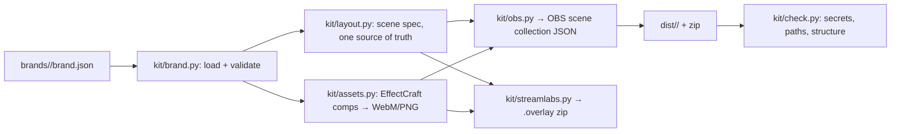

# Architecture

## Reuse vs build (GitHub-first, 2026-11-07)
Searched `gh search repos` for "obs scene collection", "obs-scene-collection", "streamlabs overlay",
"obs overlay template", "obs theme kit". Nothing reusable:
- `exeldro/obs-scene-collection-manager` (★84): an OBS plugin for backup/switching, not a generator.
- `GamesDoneQuick/typed-obs-scenes`: TypeScript enums from a collection, stale (2021).
- `trustypangolin/obs-template` (★0): an AWS Lambda templating stub, no code worth adopting.
- `MrDemonWolf/obs-setup` (★2): one person's macOS setup with Remotion overlays; not brandable.
No repo was cloned, so no repo-vetting sweep was needed. We build our own, reusing our own
EffectCraft driver from `~/Videos/FilmCraft/CTA/build_ctas.py` (the CTA pop-up pipeline) and the
CC0 Simple Icons logos from `CTA/assets/logos`.

Format facts we rely on (read from upstream source, not guessed):
- **OBS import** (`obsproject/obs-studio` `frontend/importers/studio.cpp`): any string value starting
  with `./` is turned into an absolute path relative to the imported JSON's folder (and must stay
  inside it). So the kit uses `./assets/...` everywhere and the user unzips to a permanent folder.
- **Streamlabs `.overlay`** (`stream-labs/desktop` `app/services/scene-collections/overlays.ts`):
  a zip with `config.json` at its root plus the asset files. `config.json` is a node tree:
  `RootNode{scenes: ScenesNode{items:[{name, sceneId, slots: SlotsNode{items:[…]}}]}, transition}`.
  Slot items store x/y as fractions of the base resolution and scale as `scale / base`.
  Content nodes: `ImageNode{filename}`, `VideoNode{settings, filename}`, `TextNode{settings}`,
  `WebcamNode{width,height}`, `WidgetNode{type, settings}` (URL is blank; Streamlabs links the
  importing user's own widget), `SceneSourceNode{sceneId,width,height}`. Plain browser sources and
  audio inputs have no node, so they are left out of the `.overlay`.
- OBS can import Streamlabs collections (`frontend/importers/sl.cpp`), which gives the
  "Streamlabs → OBS" route (the way Tokyo Nights reached OBS; not re-tested with this kit).

## Stack
| Piece | Choice | Why |
|---|---|---|
| Generator | Python 3 stdlib | Already installed; no deps to vet |
| Motion assets | EffectCraft CLI (headless) | Same pipeline as our CTA pop-ups; scriptable, renders alpha |
| Encoding | ffmpeg → WebM VP9 (alpha `yuva420p`) | OBS media sources play it natively with transparency |
| Icons | Simple Icons SVG (CC0) | Free, already in the CTA library |

## Components


## Data model
- `brand.json`: `name`, `handle`, `tagline`, `palette{bg,surface,primary,accent,text,muted}`
  (hex), `fonts{heading,body,files[]}`, `logo` (svg/png, relative), `socials[{platform,handle}]`,
  `style{radius,stroke,motion: calm|lively}`, `text{starting,brb,ending}`.
- Scene spec (`layout.py`): `Scene(name, items[Item])`, `Item(source, x, y, w, h, visible)`;
  `Source(name, kind, settings)` where kind ∈ media, image, text, webcam, capture, window, browser
  (placeholder), audio, scene. `w/h` are target sizes on a 1920×1080 canvas; scale is derived.
- Placeholders: `about:blank#PASTE_YOUR_<WIDGET>_URL`. `about:blank` renders transparent, so an
  unconfigured widget shows nothing on stream and the URL field says what to paste.

## Folder map
```
obs-brand-kit/
  brands/<slug>/brand.json, logo.svg, fonts/   one folder per streamer
  kit/            generator package (python -m kit ...)
    logos/        CC0 platform icons
  tests/          check suite (python -m unittest)
  dist/           build output (git-ignored)
  docs/
```

## Security
- The reference collection is read only to learn structure; nothing is copied from it.
- `kit/check.py` fails the build if the output contains: `http(s)` URLs other than an allow-list
  (none by default), long token-like strings, `C:\Users`, or the reference's handles.
- `.overlay` widgets always carry an empty URL.

## Testing
`python -m unittest` runs the checks on `dist/`. End to end: import into OBS as a new collection
(launch OBS with `--collection`, inspect via obs-websocket on a port outside 4420–4519, screenshot
each scene, then switch back to the previous collection).

Streamlabs (verified 2026-11-07, Streamlabs Desktop 1.22.4): launch it with
`--remote-debugging-port=9333`, then from its `child` window run
`require('electron').ipcRenderer.send('services-request-async', {jsonrpc:'2.0', id, method:'loadOverlay',
params:{resource:'SceneCollectionsService', args:['C:/…/X.overlay', 'X']}})`. That's what the Import
Overlay File button calls after the file picker. Use forward slashes in the path (backslashes were lost
on the way in). Result: 8 scenes, all media + stinger resolve to `%APPDATA%\slobs-client\Overlays\X\`,
widgets auto-link to the signed-in account, layout matches OBS. Streamlabs creates one image/media
source per scene item (no sharing), and shares webcam and widgets. Switch back with
`SceneCollectionsService.load(<id>)`.

## Decisions log
- **Nested shared scenes** (`◇ Webcam`, `◇ Alerts`, `◇ Socials`, `◇ Chat`) instead of Tokyo
  Nights' per-scene duplicates: paste a URL once, it updates everywhere. Alt: duplicates (rejected).
- **Global audio devices** (Desktop/Mic set to "default") instead of per-scene mic sources. Portable.
- **WebM VP9 alpha** over ProRes 4444: ~20× smaller, OBS decodes it fine.
- **about:blank placeholders** over fake `https://PASTE…` hosts: no Chromium error page on stream.
- **Text baked into rendered assets**, OBS text sources only where the streamer edits live
  (topic line, lower-third label). Keeps fonts from breaking on PCs without them.
- **Vertical canvas (Aitum Vertical), on by default.** Reference: Tokyo Nights keeps a 1080×1920
  "Aitum Vertical" canvas with the same 6 scenes sharing the horizontal inputs (webcam, alert box,
  socials, music), horizontal videos rotated 90°, cam cropped to a portrait strip, chat on top, alerts
  shrunk; timers, labels and viewer counts left out. We render dedicated portrait screens instead of
  rotating. Mechanics, from upstream source:
  - OBS 31+ restores `canvases` (`[{info:{name,uuid,flags,private}}]`) before loading sources
    (`frontend/widgets/OBSBasic_SceneCollections.cpp` → `Canvas::LoadCanvases`), and a scene whose
    `canvas_uuid` isn't found falls back to the main canvas (`libobs/obs.c`).
  - Aitum Vertical finds its canvas **by name** "Aitum Vertical" (`vertical-canvas.cpp`
    `CanvasDock::StartVideo`); a horizontal scene's `settings.canvas = [{width, height, scene}]` links
    it to a vertical scene. Its transition list lives in its own plugin config
    (`plugin_config/vertical-canvas/config.json`, global to all collections, rewritten when OBS exits),
    but each vertical scene can override the transition by name in `private_settings.transition`
    (`vertical-canvas.cpp`, `GetTransition` by source name). So the `(V)` scenes name
    `<Brand> Stinger (V)` and the kit ships `Add vertical stinger.cmd/.ps1`, which (OBS closed) appends
    that stinger to the plugin's list: nothing else in the file changes (tested by deep-compare on a
    copy), the default transition stays, re-running replaces rather than duplicates. Not installed →
    Aitum falls back to its default.
  - Without the plugin the canvas exists but has no video: the scenes stay hidden and inert. OBS ≤ 30
    ignores canvases, so a `(horizontal only).json` copy ships for it.
  - **Every item must carry relative coordinates** (`pos_rel`, `scale_rel`, `scale_ref`, `bounds_rel`;
    formulas in `obs.py::_relative`, from `libobs/obs-scene.c`). Without them OBS converts pixel values
    using the scene's size at load time, which is 0 on a plugin canvas (Aitum gives it video only after
    loading), so every vertical item landed nowhere and the plugin showed black. Test:
    `test_relative_coordinates`.
  - Verified 2026-11-07 on OBS 33 + Aitum: plugin lists the 6 `(V)` scenes, none in the main list,
    all 6 links switch, and `GetSourceScreenshot` (by scene UUID) renders them. `tools/preview_layout.py`
    composites scenes from the JSON without OBS (matched OBS pixel-for-pixel). Streamlabs `.overlay`
    stays horizontal (Dual Output not mapped yet).
- 1080p horizontal is the main canvas.
